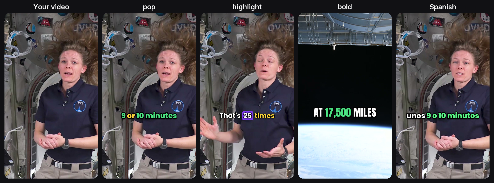
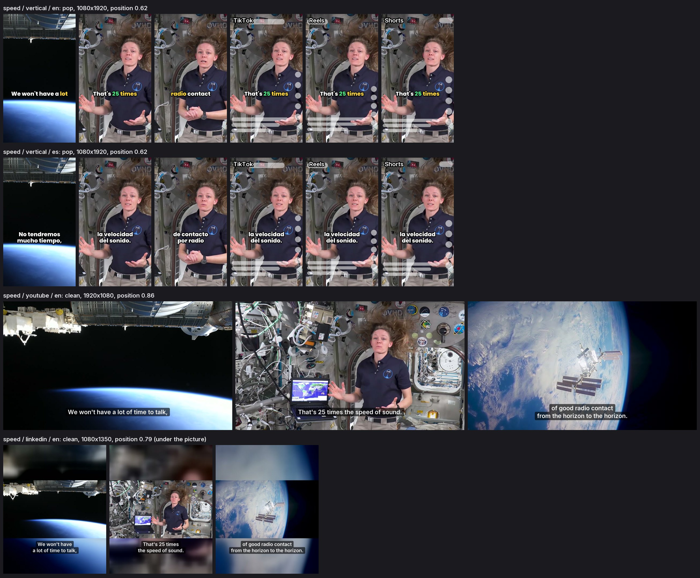
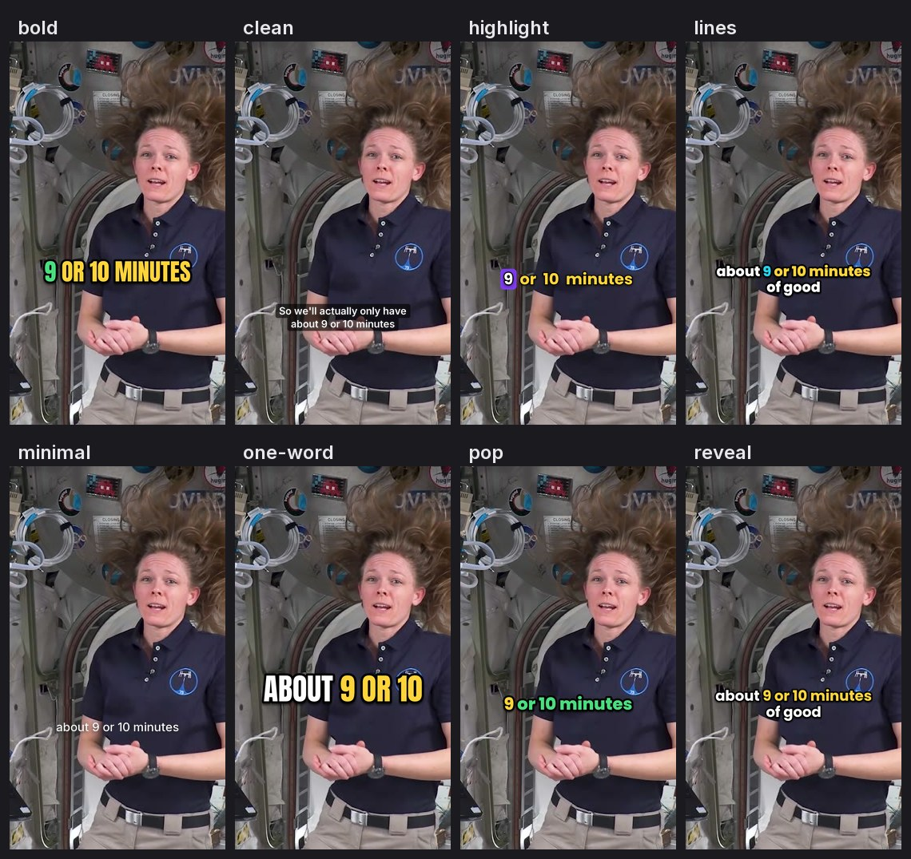

# Auto Captions Skill for Claude Code, Codex, Cursor and OpenClaw

**Auto Captions Skill** is a free, open-source auto captions skill for Claude Code and other AI agents. Your agent adds captions to your videos on your own computer: it transcribes the speech with a time for every word, proofreads names and numbers, burns in creator-style captions in the shape each app wants, writes SRT and VTT subtitle files, translates the captions into other languages, and, if you want, posts or schedules the captioned videos through [WoopSocial](https://woopsocial.com/?utm_source=auto-captions-skill&utm_medium=readme) after you say yes:

- free transcription on your computer (faster-whisper, or mlx-whisper on Apple Silicon), your own Groq or Deepgram key for long videos, or the video's existing subtitles;
- the agent proofreads every line before anything is burned in, using your list of names and terms;
- 8 caption styles: the spoken word highlighted, big bold words, a coloured pill, words revealed as spoken, two-line, clean subtitles, minimal, one word at a time;
- 9:16, 4:5, 1:1 or 16:9 from any video, cropped where you choose or placed on a blurred background;
- a review sheet with TikTok's, Reels' and Shorts' buttons drawn on, so captions stay clear of them;
- SRT, VTT and a transcript with every video, for accessibility and for apps that take a subtitle file;
- captions in other languages with the same timing, including right-to-left scripts and Chinese, Japanese and Korean;
- whole folders at once, picking up where it stopped.

No watermark, no per-minute limit, no paid API. Python, Pillow and ffmpeg. MIT licensed.

```bash
npx skills add social-media-skills/auto-captions-skill -g -a claude-code -y
```

**Post it from your agent:** to have your agent schedule the captioned videos to TikTok, Instagram, YouTube and more, [make a free WoopSocial account](https://app.woopsocial.com/signup?utm_source=auto-captions-skill&utm_medium=readme&utm_content=top) (free for 2 social accounts, no card).



*From the example in [`examples/iss-radio/`](skills/auto-captions-skill/examples/iss-radio/): two clips of NASA astronaut Nichole Ayers on the International Space Station, captioned in English and Spanish for TikTok, Reels, Shorts, YouTube and LinkedIn. Every file in it was made by the skill's scripts. See [CREDITS](skills/auto-captions-skill/examples/iss-radio/CREDITS.md).*

## Contents

- [What the auto captions skill does](#what-the-auto-captions-skill-does)
- [Requirements](#requirements)
- [Install](#install)
- [Example: add captions to a video with Claude Code](#example-add-captions-to-a-video-with-claude-code)
- [Caption styles](#caption-styles)
- [Subtitle files and accessibility](#subtitle-files-and-accessibility)
- [Captions in other languages](#captions-in-other-languages)
- [Posting the captioned videos](#posting-the-captioned-videos)
- [FAQ](#faq)
- [What's inside](#whats-inside)

## What the auto captions skill does

Tell your agent "add captions to this video", "caption this folder for TikTok and Reels", "make an SRT for my YouTube video" or "make a Spanish version with subtitles", and it does the whole job:

1. **Asks** where the videos will go, which names must be spelled right, and which languages.
2. **Transcribes** with `transcribe.py`: every word with its time.
3. **Proofreads** with `fix.py`: you see the unsure words and near-misses of your names, the agent corrects them, and every word keeps its time.
4. **Writes subtitle files** with `captions.py`: SRT, VTT and a transcript, cues of at most two lines broken at punctuation.
5. **Shows the styles** on your own video with `styles.py`, so you pick one by looking at it.
6. **Shows a review sheet** with `render.py --preview`: three moments per version, and each app's buttons drawn on the vertical ones.
7. **Renders** every video in every shape and language, ready to post.
8. **Plans the posts** if you want: `post_plan.py` checks each file against each platform, schedules one a day per account, and posts through WoopSocial after one clear yes.

## Requirements

- Python 3.9 or newer with Pillow (`pip install pillow`); on Windows also `pip install tzdata` for scheduling.
- ffmpeg (any build: captions are drawn with Pillow, so ffmpeg needs no subtitle library).
- One way to transcribe: `pip install faster-whisper` (free, runs locally; the model downloads once), `pip install mlx-whisper` on Apple Silicon, a `GROQ_API_KEY` or `DEEPGRAM_API_KEY`, or the video's own .srt/.vtt.
- An agent that can run commands on your computer (Claude Code, Codex, Cursor, OpenClaw or similar).

`python3 scripts/check_setup.py` tells you what's missing and the install command for your system. A CI workflow runs the full pipeline on macOS, Windows and Ubuntu, and a real transcription with faster-whisper.

## Install

**Claude Code**

```bash
npx skills add social-media-skills/auto-captions-skill -g -a claude-code -y
```

**Codex, Cursor and other agents:** run `npx skills add social-media-skills/auto-captions-skill` and pick your agent, or copy `skills/auto-captions-skill/` into your agent's skills directory.

**OpenClaw (ClawHub):** `openclaw skills install @social-media-skills/auto-captions-skill`

**GitHub CLI:** `gh skill install social-media-skills/auto-captions-skill auto-captions-skill`

**Gemini CLI:** `gemini extensions install https://github.com/social-media-skills/auto-captions-skill`

## Example: add captions to a video with Claude Code

> Add captions to clips/intro.mp4 and clips/speed.mp4 for TikTok, Reels and Shorts, a 16:9 version for YouTube, a 4:5 version for LinkedIn, and a Spanish version. Her name is Nichole Ayers.

The agent writes a job file:

```json
{
  "videos": [{"file": "clips/intro.mp4", "id": "intro"}, {"file": "clips/speed.mp4", "id": "speed"}],
  "language": "en",
  "vocab": ["Nichole Ayers", "International Space Station", "ISS", "ham radio"],
  "translations": ["es"],
  "outputs": [
    {"id": "vertical", "style": "pop", "canvas": "9:16", "fit": "crop", "focus_x": 0.57},
    {"id": "youtube", "style": "clean", "canvas": "source", "languages": ["en"]}
  ]
}
```

Then it runs:

```bash
python3 <skill>/scripts/transcribe.py captions.json     # 19 s for both clips on a laptop, after the one-time model download
python3 <skill>/scripts/fix.py captions.json --report   # what to check
# the agent reads work/<id>/transcript.txt and writes work/<id>/fixes.json
python3 <skill>/scripts/captions.py captions.json       # SRT, VTT, transcript, translation templates
# the agent fills work/<id>/translate.es.json
python3 <skill>/scripts/styles.py captions.json --at 9.9
python3 <skill>/scripts/render.py captions.json --preview
python3 <skill>/scripts/render.py captions.json         # six captioned videos
```

The transcription missed a word and most commas; the proofread put them back, because commas decide where captions break. The review sheet shows each version with TikTok's, Reels' and Shorts' buttons drawn on:



## Caption styles

All 8 presets on one frame of the example, made by `styles.py`:



| Style | Looks like | Good for |
|---|---|---|
| `pop` | 1 to 3 words, thick outline, spoken word yellow, keywords green | TikTok, Reels, Shorts |
| `bold` | 1 or 2 big uppercase words | High-energy talking heads |
| `highlight` | spoken word on a coloured pill (your brand colour) | Brands |
| `reveal` | words appear as spoken, up to 2 lines | Explainers |
| `lines` | two short lines, spoken word highlighted | Fast talkers |
| `clean` | sentence case on a soft band, low in the frame | YouTube, LinkedIn, podcasts |
| `minimal` | small lowercase words, soft shadow | Lifestyle, voiceovers |
| `one-word` | one huge word at a time | Hooks, very short clips |

Every setting (font, size, colours, outline, words per caption, position) can be changed per output, or saved as your own style file. Captions never end on "the" or split "9 or 10 minutes", and they stay up through short pauses.

## Subtitle files and accessibility

Burned-in captions can't be resized or read aloud, so every video also gets an SRT and a VTT (each cue at most 2 lines of 42 characters, broken at punctuation; cues follow the speaker word for word, so a fast speaker gives fast cues) and a plain transcript. YouTube and Facebook let you add a subtitle file viewers can switch on; TikTok and Instagram take none through their APIs, and LinkedIn and X take one only when you upload in their own app, which is why the skill burns captions in. For long YouTube videos the subtitle file alone is often the better choice. Sound tags like `[laughter]` go in the subtitle file, and in the video if you ask.

## Captions in other languages

For every language you add, the agent translates each subtitle cue in a template with the original's timing, so the translation stays in sync. It keeps names and numbers and converts units for the audience (17,500 mph became 28 000 km/h in the Spanish example). Arabic, Hebrew, Persian and Urdu need `pip install arabic-reshaper python-bidi`; Chinese, Japanese and Korean use a font on your computer or download a free Noto font once. Translated versions show whole captions without the moving highlight, because a translation has no spoken word to follow.

## Posting the captioned videos

Tell the agent where the videos are going and it writes the post texts and a schedule after the captions are done. The plan works without connecting anything: `plan.md` lists every file, post text and time, and where to add each subtitle file, so you can post by hand. `post_plan.py` checks every file against each platform (length, size, frame rate, shape, text limits), gives each account its own version and language, schedules at most one post a day per account, and writes one request per post. The agent uploads each file once, validates every request, shows you the plan and waits for one clear yes before anything is scheduled.

Posting runs through [WoopSocial's MCP for AI agents](https://woopsocial.com/agents?utm_source=auto-captions-skill&utm_medium=readme), made by the team that maintains this skill. It posts to TikTok, Instagram, YouTube, Facebook, LinkedIn, X, Threads and Bluesky through each platform's own API, so you need no developer app of your own. The free plan covers 2 social accounts.

## FAQ

**How accurate is it?** As accurate as the transcription engine, then corrected by the agent. The usual mistakes are names, brands and numbers, which is why the agent reads every line and asks you only about spellings it can't know. Use `--model turbo` for hard audio.

**Is it really free?** Yes. Transcription and rendering run on your computer. A Groq key (about $0.04 per hour of audio) or Deepgram key is optional, for speed or speaker labels.

**How long does it take?** On a laptop, transcribing takes a fraction of the video's length with the "small" model, and rendering one to three times the video's length per version, depending on the computer.

**My phone video came out grey or washed out.** It was filmed in HDR. The skill converts HDR when ffmpeg has the zscale filter; the standard Homebrew ffmpeg doesn't, and the skill then says so. Export the clip as SDR first (iPhone: share it with Options > Most Compatible), or turn off HDR Video in the camera settings for new clips.

**Do captions help my videos reach more people?** No platform has confirmed that burned-in captions help ranking. They let people follow with the sound off, and the post text is what search reads; the skill helps with both.

**Can it caption music or several speakers?** Singing and loud music transcribe poorly; caption from a clean voice track if you have one. Deepgram labels speakers, and captions break when the speaker changes.

**Does it work without WoopSocial?** Yes. Everything up to posting is local; you upload the captioned videos yourself. The posting plan too: `plan.md` has every file, text and time to post by hand.

## What's inside

```
skills/auto-captions-skill/
  SKILL.md                 the workflow the agent follows
  scripts/
    check_setup.py         what's installed, and how to add what isn't
    transcribe.py          words with times: faster-whisper, mlx-whisper, Groq, Deepgram or existing subtitles
    fix.py                 what to proofread; applies the agent's fixes with word times kept
    captions.py            SRT, VTT and transcript; translation templates
    styles.py              every caption style on a frame of your video
    render.py              review sheet; burns captions in every shape and language
    post_plan.py           platform checks, schedule, WoopSocial requests, plan.md
    upload_parts.py        uploads files to WoopSocial
    aclib.py               shared helpers
  styles/                  8 caption presets (JSON)
  references/              job file, proofreading, translation, styles, platforms, posting, WoopSocial
  fonts/                   Poppins, Anton and Inter (SIL Open Font License)
  examples/iss-radio/      two NASA clips with every file the skill makes
  evals/evals.json         test prompts
```

The NASA footage in the example is credited in [CREDITS](skills/auto-captions-skill/examples/iss-radio/CREDITS.md); its use doesn't imply endorsement by NASA.

More free skills for social media from the same team: [social-media-skills.com](https://social-media-skills.com/?utm_source=auto-captions-skill&utm_medium=readme).
